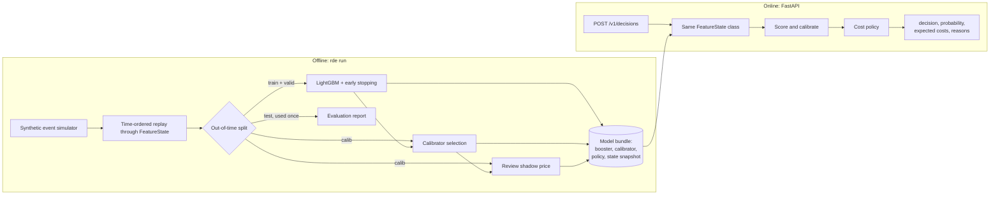
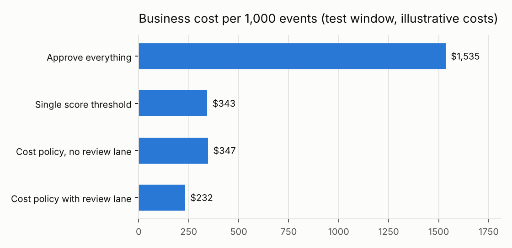
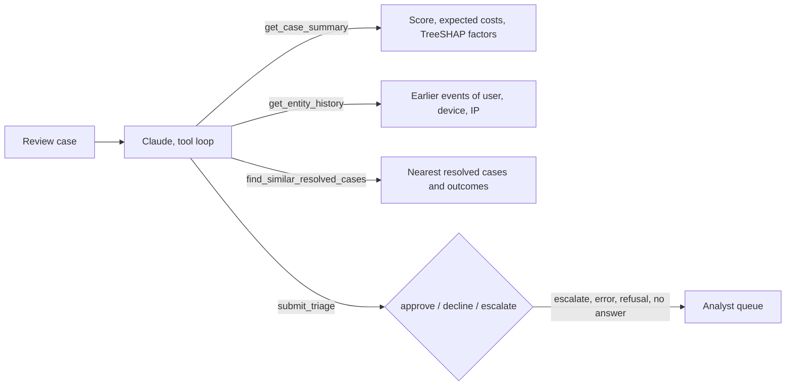

# Risk Decisioning Engine

**A fraud model is only useful when it makes a decision that saves money.** This repository is
a complete, reproducible reference implementation of that idea: from raw signup and purchase
events to a calibrated risk score, a cost-based **approve / review / decline** decision, and an
HTTP API that returns the decision together with its expected cost and reasons.

[](https://github.com/Scarta19/risk-decisioning-engine/actions/workflows/ci.yml)


> **Data notice.** Everything here runs on **synthetic data** generated by the simulator in
> `src/rde/data/synthetic.py`, and the business costs are **illustrative assumptions** in
> `configs/default.yaml`. No real customer, employer or proprietary data, code or rules are
> used. The numbers below show how the method behaves; they are not claims about real-world
> fraud performance.

## What it does

| Stage | What happens | Where |
|---|---|---|
| Simulate | 120 days of signups and purchases from 15k users, with card testing, account takeover, bot/install farms and friendly fraud mixed into legitimate behaviour | `rde/data/synthetic.py` |
| Featurise | 19 point-in-time features (velocity, shared devices and IPs, spend vs. own history, click-to-conversion time, geo mismatch) computed by **one class used both offline and online** | `rde/features/state.py` |
| Train | LightGBM with early stopping on an out-of-time window | `rde/modeling/train.py` |
| Calibrate | Platt vs. isotonic vs. none, chosen on a later, held-out time slice | `rde/modeling/calibration.py` |
| Decide | Expected cost of each action from unit economics; review capacity enforced with a shadow price | `rde/decision/policy.py` |
| Evaluate | Ranking, calibration, business cost vs. baselines, recall per fraud pattern, PSI drift | `rde/evaluation/` |
| Triage | LLM agent that investigates review cases and recommends approve, decline or escalate | `rde/triage/` |
| Serve | FastAPI service with validation, reason codes (TreeSHAP) and a warm state snapshot | `rde/serving/` |

## Architecture



## Results on the default synthetic run

Out-of-time split: train Jan 1 to Mar 16, early-stopping window to Mar 31, calibration and
policy tuning Apr 1 to 15, test Apr 16 to 30 (17,471 events, 2.67% fraud). Full report with
figures: [`reports/evaluation.md`](reports/evaluation.md).

| Test window | Value |
|---|---:|
| ROC AUC | 0.962 |
| Average precision | 0.919 |
| Log loss, raw → calibrated (Platt) | 0.02103 → 0.02067 |

| Policy (test window) | Cost per 1k events | Fraud intercepted | Legit declined | Review rate |
|---|---:|---:|---:|---:|
| Approve everything | $1,535 | 0.0% | 0.00% | 0.0% |
| Single score threshold, tuned on calib window | $343 | 89.1% | 0.12% | 0.0% |
| Cost policy, approve/decline only | $347 | 88.6% | 0.11% | 0.0% |
| **Cost policy with review lane** | **$232** | **90.1%** | **0.01%** | **0.9%** |



What the run shows, including the less flattering parts:

* **Most of the gain comes from the review lane, not from amount-aware thresholds.** With only
  approve and decline, the cost policy is about equal to a single threshold tuned on the
  calibration window. Adding a cheap human review for the uncertain middle cuts cost by about a
  third and nearly eliminates false declines of good customers.
* **Review precision is 8%, and that is the intended outcome.** A review costs $3 in this config
  and a missed fraud costs the order value plus a $15 fee, so reviewing a case with a few percent
  fraud risk is rational. The thresholds come from the costs, not from intuition.
* **Calibration helped only slightly here** because the model is trained without class
  re-weighting. The fraud rate also moves between windows (3.9% in train, 1.4% in calib, 2.7% in
  test), which is exactly why calibration is refit on a recent window rather than trusted once.
* **Friendly fraud is not caught (0%).** By construction it looks identical to legitimate
  purchases. No feature set fixes that; it needs different signals (dispute history, delivery
  data) or a different control.
* **Synthetic patterns are cleaner than real ones,** so absolute AUC values here are optimistic.
  The value of the repository is the method and the engineering, not the score.

## Triage agent for the review lane

The cost policy sends about 1% of events to a human analyst. `rde.triage` adds an LLM agent
that prepares each of those reviews: it investigates the case with read-only tools and
recommends **approve**, **decline** or **escalate** (leave it to the analyst), with a confidence,
a suspected fraud pattern and the evidence it used.



**Guardrails built in.**

* **No answer leakage.** The tools only return what is known at decision time. Labels of the
  open cases are unreachable; resolved reference cases come from an earlier window. Tests
  check both.
* **Fail closed.** A refusal, a tool error loop, a missing or invalid submission or a turn limit
  all end in `escalate`, which costs exactly what the review lane costs today.
* **Strict tool schemas** (`strict: true`) so every submission has a valid recommendation,
  confidence, pattern and evidence list. Evidence must name the tool it came from, and the
  evaluation checks that the agent actually called that tool.
* **Claude Opus 5.5** with adaptive thinking, a cached system prompt and tool list, and
  server-side fallback if the model declines a request.

**The bar it has to clear is high, on purpose.** On the default run the review lane holds 156
test-window cases, 8.3% of them fraud. Sending all of them to an analyst costs $5.91 per case.
Letting the model alone decide (decline if p ≥ 0.5) costs $19.64 per case, because one approved
fraud loses the whole order. So the agent only adds value if it automates the easy cases with
very high accuracy, escalates the rest, and does it for less than the saving.
`rde triage-eval` measures exactly that against those baselines and a perfect-information
lower bound, and reports LLM cost per case, latency and errors.

```bash
pip install -e ".[dev,agent]"
export ANTHROPIC_API_KEY=...            # needed only for the real evaluation
rde triage-eval --n 60                  # stratified sample of review cases, Claude Opus 5.5
rde triage-eval --backend heuristic     # offline harness check, no API calls
```

**Results (Claude Opus 5.5, effort `medium`, 60 stratified review cases, seed 0).** Full report:
[`reports/triage/triage_evaluation.md`](reports/triage/triage_evaluation.md), per-case output in
`reports/triage/triage_cases.jsonl`.

| Strategy | Per case | Sent to analysts | Fraud approved | Good customers declined |
|---|---|---|---|---|
| escalate_all (today) | $6.03 | 100% | 0 | 0 |
| model_only (decline if p ≥ 0.5) | $13.67 | 0% | 3 | 2 |
| **agent** | **$5.03** + $0.048 LLM | **75%** | **0** | **0** |
| oracle (lower bound) | $0.00 | 0% | 0 | 0 |

* The agent automated 15 of 60 cases (all approvals, all correct) and escalated the other 45.
  It declined none on its own.
* Net saving vs. escalate_all: **$57.14 on 60 cases** (about $0.95 per case) after $2.86 of LLM
  cost. Zero errors, zero refusals; evidence always came from tools it actually called; it named
  the right fraud pattern on 4 of 5 fraud cases. Latency p50 13.8 s, p90 18.2 s, 5.45 tool calls
  per case on average.
* The per-case baselines differ from the full-lane figures above ($5.91 and $19.64) because this
  is a 60-case sample of the 156; compare strategies within the same table.

**Limits.** 60 cases and 15 automated decisions are a small sample: 0 errors in 15 does not prove
a low error rate. Data is synthetic and costs are illustrative. The agent is conservative by
design, so most of the review cost remains; the next steps are a run on all 156 cases and an
effort and model comparison.

## Design decisions

**One feature implementation for training and serving.** `FeatureState.compute` and `update`
are the only definitions of the features. Training builds its matrix by replaying events in
time order through that class; the API calls the same methods per request. Two tests enforce
this: `test_no_future_leakage` (features of the first N events do not change when later
events are appended) and `test_bundle_round_trip_and_training_serving_parity` (replaying
history through the API path reproduces the offline features, scores and decisions exactly).

**Out-of-time evaluation only.** Four consecutive windows: train, early stopping, calibration
and policy tuning, and a test window that is used once. Random splits would leak campaign
structure across the boundary and overstate performance.

**Decisions from unit economics.** For probability `p` and amount `a`:

```
approve = p · (fraud_fixed + fraud_rate · a)
decline = (1 − p) · (false_decline_fixed + margin_rate · a)
review  = review_fixed + λ + p · (1 − catch_rate) · fraud_loss(a) + (1 − p) · review_friction
```

The cheapest action wins, so a $5 order and a $2,000 order with the same score can get
different decisions. λ is a shadow price on analyst capacity, tuned on the calibration window so
the review rate stays under `review_capacity`. Because it is a single number, the same rule runs
in batch evaluation and in the API. (In the default run capacity was not binding, so λ = 0;
`test_review_price_enforces_capacity` covers the binding case.)

**Stationary features.** An early version used an all-time count of a user's purchases; its PSI
between train and test was 0.86 because the counter grows with the age of the system. It was
replaced by 30-day windows (PSI now ≤ 0.09 for every feature).

**Explainable decisions.** Each response includes the top features pushing the score up,
from LightGBM's exact TreeSHAP contributions, so a reviewer sees why a case was flagged.

## Quickstart

```bash
python -m venv .venv && source .venv/bin/activate
pip install -e ".[dev]"

rde run                     # simulate, train, calibrate, evaluate (about 20 s)
rde serve                   # API on http://127.0.0.1:8000, docs at /docs

curl -s -X POST localhost:8000/v1/decisions \
  -H 'content-type: application/json' -d @examples/purchase.json
```

Or with Docker (the image trains its own bundle at build time, so no binaries live in Git):

```bash
docker build -t risk-decisioning-engine .
docker run --rm -p 8000:8000 risk-decisioning-engine
```

### Example

`examples/purchase.json` is a $480 card purchase at 03:12 UTC from an established US customer,
on a device and network never seen before, with an IP in another country.
`examples/purchase_typical.json` is the same customer buying $46 from their usual device.

```jsonc
// examples/purchase.json  ->  decline
{
  "decision": "decline",
  "fraud_probability": 0.988,
  "expected_cost": { "approve": 489.27, "review": 51.94, "decline": 1.72 },
  "reasons": [
    { "feature": "amount", "value": 480.0 },
    { "feature": "amount_to_user_mean_30d", "value": null },
    { "feature": "geo_mismatch", "value": 1.0 }
  ]
}
// examples/purchase_typical.json  ->  approve, fraud_probability 0.001
```

### API

| Method | Path | Purpose |
|---|---|---|
| `GET` | `/health` | Liveness |
| `GET` | `/v1/model` | Model version, data hash, training windows, calibration method, review price |
| `POST` | `/v1/decisions?record=true` | Decide one event; `record=false` scores without updating state |

Requests are validated strictly: unknown fields, negative amounts, timezone-naive timestamps
and purchases without a payment method return `422`.

## Repository layout

```
configs/            default.yaml (all assumptions), small.yaml (tests and CI)
src/rde/
  data/             synthetic event simulator
  features/         FeatureState: point-in-time features, offline and online
  modeling/         LightGBM training, reason codes, calibration
  decision/         cost-based policy and capacity shadow price
  evaluation/       metrics, PSI, Markdown and PNG report
  serving/          FastAPI app and request/response schemas
  triage/           LLM triage agent: case tools, agent loop, Claude backend, evaluation
  engine.py         model bundle: booster + calibrator + policy + state snapshot
  pipeline.py       end-to-end offline pipeline
tests/              46 tests: leakage, parity, policy math, calibration, API contract, triage agent
reports/            generated evaluation report and figures
```

## Production notes and known limitations

This is a reference implementation. Before production use you would change at least:

* **Online state store.** State is in-process, so the service runs one worker. A real
  deployment backs the `FeatureState` interface with a shared TTL store (for example Redis)
  and handles late or out-of-order events explicitly.
* **Label delay.** Chargebacks arrive weeks after the transaction. The simulator assigns labels
  instantly; a real pipeline must wait for label maturity before training or calibrating.
* **Feedback loop.** Declined events never reveal their true label. Production systems keep a
  small random holdout of approvals to measure performance without bias.
* **Monitoring.** PSI is computed offline here. In production it would run on live traffic,
  together with score distribution, decision-rate and cost alerts.
* **Costs.** The unit economics in `configs/default.yaml` are placeholders and should come from
  finance and operations data.

## Roadmap

- [ ] Drift scenario in the simulator (fraud adapts after a model launch) and a retraining trigger
- [ ] Label-delay simulation and maturity-aware training windows
- [ ] Redis-backed `FeatureState` and a load test
- [ ] Champion/challenger evaluation on the same decision policy
- [x] Triage agent: publish the Claude evaluation
- [ ] Triage agent: run on all review cases, then compare effort levels and models

## Author

Built by [Santiago Cartagena](https://github.com/Scarta19), ML engineer focused on fraud,
risk decisioning and production ML systems. This is an independent project and is not
affiliated with or endorsed by any employer.

Licensed under the [MIT License](LICENSE).
