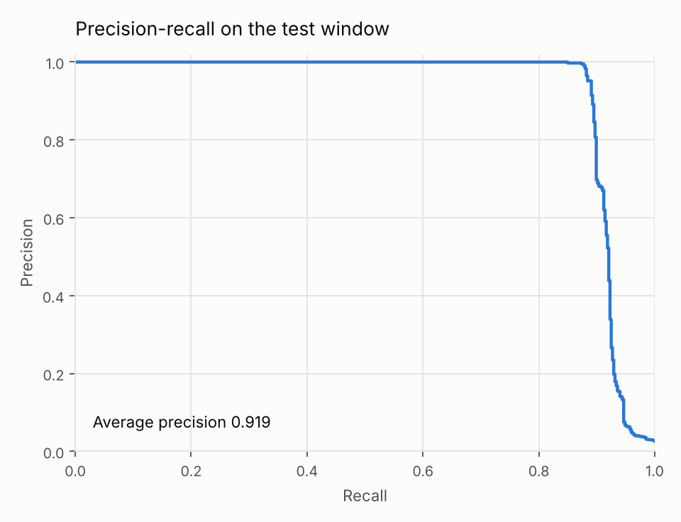
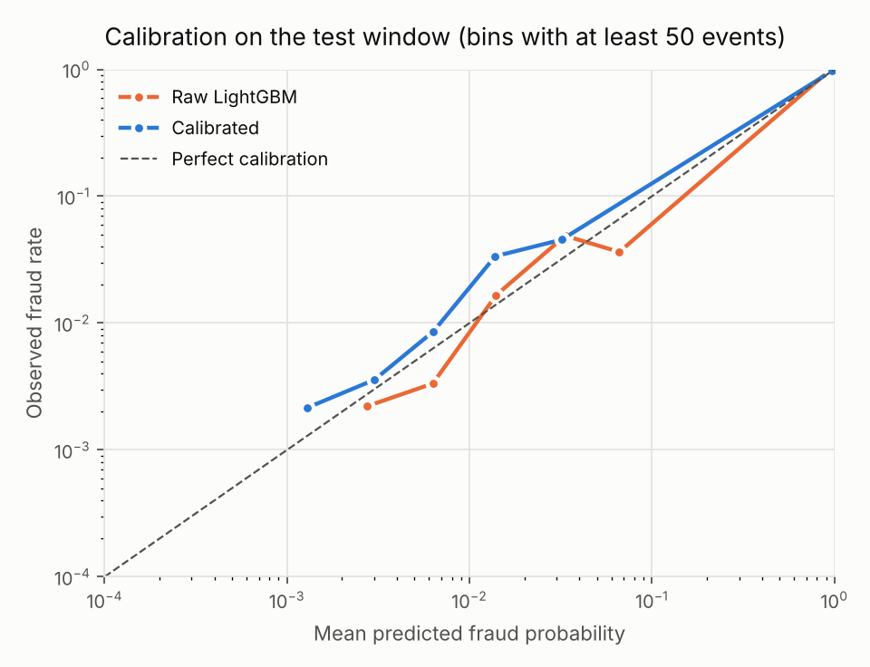
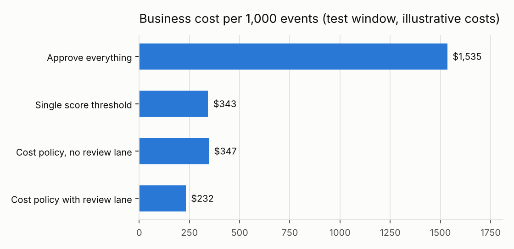

# Evaluation report

> Generated by `rde run`. All numbers come from **synthetic data** produced by this
> repository's simulator and **illustrative cost assumptions** in the config. They
> demonstrate the method; they are not estimates of real-world fraud performance.

Model version `0.1.0+ccec528112c9` · best iteration 72 · calibration `platt`

## Data and out-of-time split

| Window | Dates | Events | Fraud rate |
|---|---|---:|---:|
| train | 2026-01-01 to 2026-03-16 | 72,749 | 3.93% |
| valid | 2026-03-17 to 2026-03-31 | 16,199 | 2.99% |
| calib | 2026-04-01 to 2026-04-15 | 16,796 | 1.42% |
| test | 2026-04-16 to 2026-04-30 | 17,471 | 2.67% |

Train fits the model, valid drives early stopping, calib fits the calibrator, the
review shadow price and the baseline threshold, and test is touched only once.

## Ranking (test window)

| ROC AUC | Average precision | Base rate |
|---:|---:|---:|
| 0.962 | 0.919 | 2.67% |

## Calibration (test window)

| Scores | Brier | Log loss | ECE |
|---|---:|---:|---:|
| raw | 0.00344 | 0.02103 | 0.00212 |
| calibrated | 0.00344 | 0.02067 | 0.00148 |

Calibrator selection (log loss on the most recent third of the calib window): identity 0.01700, platt 0.01614, isotonic 0.02057.

## Decisions and business cost (test window)

| Policy | Cost / 1k events | Approve | Review | Decline | Fraud intercepted | Fraud $ intercepted | Legit declined | Review precision |
|---|---:|---:|---:|---:|---:|---:|---:|---:|
| Approve everything | $1,535 | 100.00% | 0.00% | 0.00% | 0.00% | 0.00% | 0.00% | n/a |
| Single score threshold | $343 | 97.50% | 0.00% | 2.50% | 89.06% | 83.77% | 0.12% | n/a |
| Cost policy, no review lane | $347 | 97.53% | 0.00% | 2.47% | 88.63% | 83.77% | 0.11% | n/a |
| Cost policy with review lane | $232 | 96.77% | 0.89% | 2.34% | 90.13% | 90.05% | 0.01% | 8.33% |

Review shadow price fitted on the calib window: $0.00 (0 means the capacity limit was not binding). Single-threshold baseline cut-off: 0.2589.

## Interception by fraud pattern (cost policy, test window)

| Pattern | Fraud events | Reviewed or declined |
|---|---:|---:|
| account_takeover | 77 | 87.01% |
| bot_farm | 300 | 99.00% |
| card_testing | 58 | 96.55% |
| friendly_fraud | 31 | 0.00% |

## Feature drift, train vs test (PSI, top 6)

| Feature | PSI |
|---|---:|
| `log_account_age_days` | 0.088 |
| `user_purchases_30d` | 0.062 |
| `amount_to_user_mean_30d` | 0.045 |
| `log_click_to_conversion_sec` | 0.009 |
| `amount` | 0.005 |
| `log_amount` | 0.005 |

Rule of thumb: below 0.1 stable, 0.1 to 0.25 watch, above 0.25 investigate.

## Feature importance (gain share, top 8)

| Feature | Share |
|---|---:|
| `ip_users_24h` | 47.0% |
| `ip_events_1h` | 17.2% |
| `log_account_age_days` | 10.9% |
| `amount` | 7.5% |
| `source_signups_1h` | 3.4% |
| `user_amount_24h` | 2.9% |
| `log_click_to_conversion_sec` | 2.9% |
| `log_amount` | 2.1% |
