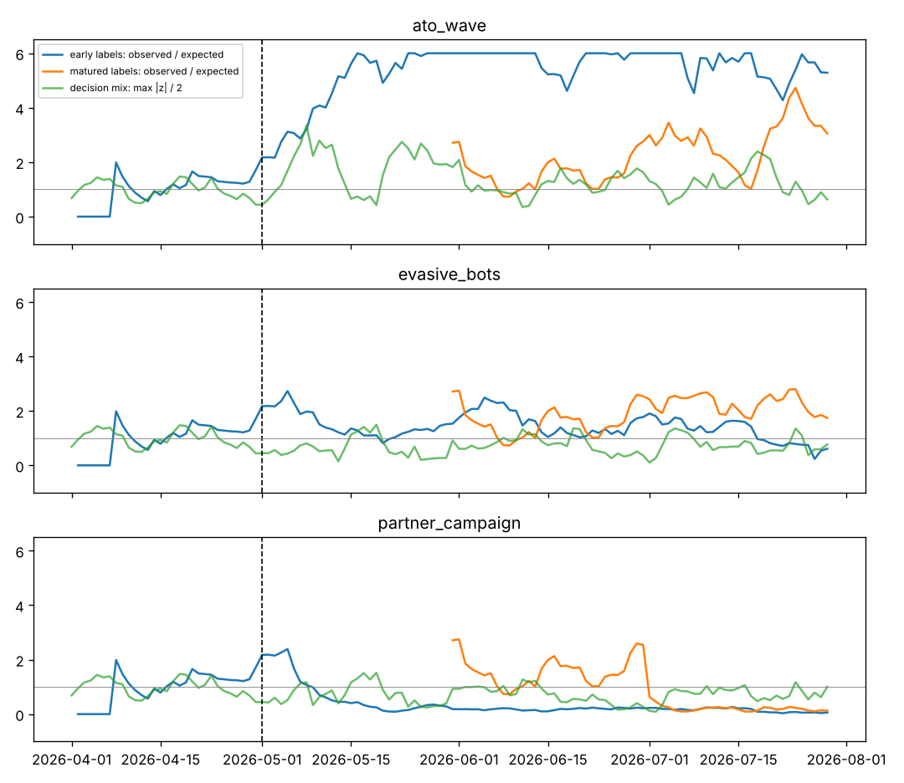

# Monitoring under delayed labels

Deployed 2026-04-01; incident starts 2026-05-01; fraud labels mature after 60 days. Synthetic data, illustrative costs.

## When each monitor first raises an alarm (days after the incident starts)

| Scenario | Excess cost / day | Feature PSI | Score PSI | Decision mix | Early labels (age-adjusted) | Matured labels |
|---|---:|---|---|---|---|---|
| none | $0 | no alarm | no alarm | no alarm | 3 false alarm days | 3 false alarm days |
| ato_wave | $327 | not detected | not detected | day 6 | day 4 (excess) | day 62 (excess) |
| evasive_bots | $11 | not detected | not detected | not detected | day 34 (excess) | day 65 (excess) |
| partner_campaign | $28 | not detected | not detected | not detected | day 15 (deficit) | day 63 (deficit) |

## Money lost before the first alarm

| Scenario | Feature PSI | Score PSI | Decision mix | Early labels (age-adjusted) | Matured labels |
|---|---:|---:|---:|---:|---:|
| ato_wave | $29,475 | $29,475 | $2,756 | $2,179 | $20,502 |
| evasive_bots | $1,003 | $1,003 | $1,003 | $375 | $733 |
| partner_campaign | $2,512 | $2,512 | $2,512 | $378 | $1,630 |

## Robustness across 8 simulated worlds

Detected in how many seeds, and the median first-alarm day when detected.

| Scenario | Feature PSI | Score PSI | Decision mix | Early labels (age-adjusted) | Matured labels |
|---|---|---|---|---|---|
| none | no alarm | no alarm | 8 false days | 4 false days | 7 false days |
| ato_wave | 0/8 | 0/8 | 7/8, median day 8 | 8/8, median day 12 | 6/8, median day 66 |
| evasive_bots | 0/8 | 0/8 | 3/8, median day 26 | 2/8, median day 36 | 6/8, median day 68 |
| partner_campaign | 1/8, median day 22 | 0/8 | 3/8, median day 15 | 7/8, median day 19 | 5/8, median day 64 |

## Reference at deployment

* Feature and score reference: 2026-03-17 to 2026-03-31, 7,981 events.
* Decision-rate reference: 2026-03-02 to 2026-03-31; decline rate 3.32% (dispersion 29.2x binomial), review rate 1.21% (dispersion 1.0x).
* Approved-event calibration factor 0.84 (observed / predicted fraud among approved events).
* Label-delay curve from 554 matured fraud labels; median 23 days, 90th percentile 55 days.

